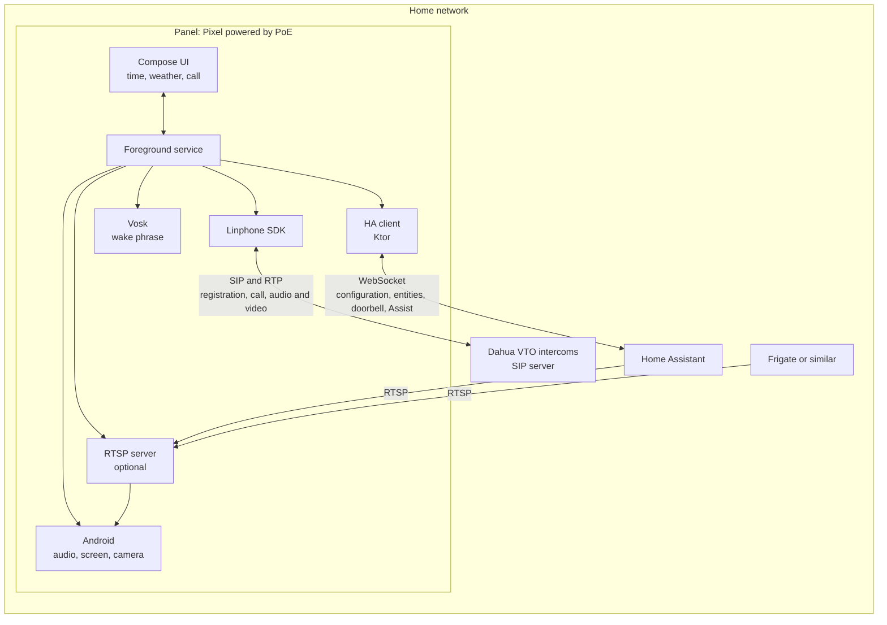

# marc2d

[](https://github.com/xoadev/marc2d/actions/workflows/ci.yml)

**M**óvil **A**ndroid **R**eciclado **C**omo **C**onsola **D**omótica: MAR + C² + D. In English, a
recycled Android phone turned into a home console.

marc2d turns an old phone, fixed to the wall, into your home's console: clock and weather, video
intercom, cameras, siren and sensors, connected to [Home Assistant](https://www.home-assistant.io/). The
logic stays in Home Assistant: the panel is not the hub.

It's a half-joking personal project, shared in case it's useful to someone.

## What it does

- **Clock and weather** on a black screen, designed for OLED panels that stay on all day.
- **Intercom:** it rings, you answer with audio and video, and you can call it yourself. Tested with a
  Dahua VTO2202F.
- **Cameras** from Home Assistant in full screen, swiping from one to the next.
- **Sensors and siren** in Home Assistant: light, battery and a siren on the alarm channel.
- **A speaker** for `tts.speak` and any other audio from Home Assistant.
- **Voice commands**, off by default: it listens for "Oye Mark" on the device and sends what follows to Assist.
- **A droid**, 16×16 pixels, that wanders around the screen and shows what's going on with the color of
  its eye.

## Status

In testing, with a single panel and no releases. Things still break freely.

## What you need

- A phone with Android 15 or later. It's used with LineageOS and without Google services.
- Home Assistant.
- For the intercom, a device that works as a SIP server on your home network.

## Architecture



| Connection  | Who starts it | What for                                                 |
| ----------- | ------------- | -------------------------------------------------------- |
| SIP and RTP | both          | the panel registers; the intercom calls; audio and video |
| WebSocket   | the panel     | configuration, entities, doorbell, weather, Assist       |
| RTSP        | HA or Frigate | reading the video; the camera is only on during it       |

The intercom only works from the home network: over Tailscale, the subnet router's SNAT prevents the
intercom from reaching the panel.

## Stack

Kotlin and Jetpack Compose on Kotlin Toolchain, Linphone SDK, Ktor Client, kotlinx.serialization,
DataStore, Vosk, CameraX and ZXing, with our own small RTSP server for the camera. The reasons are in
[SPEC.md](SPEC.md#decisions).

## Development

The `./kotlin` script downloads what it needs, with nothing to install first.

```sh
./kotlin build -m app        # builds the APK
./kotlin check               # ktlint, Compose rules and tests
./kotlin do ktlintFormat     # fixes the formatting

adb -s <serial> install -r build/tasks/_app_buildAndroidDebug/gradle-project-debug.apk
```

CI runs the same, plus markdownlint. The working rules are in [AGENTS.md](AGENTS.md).

## Setting up a panel

1. In Home Assistant, install the integration: in HACS, add this repository as a custom repository of type
   Integration.
2. Install the APK on a phone with no screen lock or accounts, and enable kiosk mode on it:

   ```sh
   adb -s <serial> shell dpm set-device-owner dev.xoa.marc2d/.PanelAdminReceiver
   ```

3. On LineageOS with restricted networking enabled, new apps have no network. Go to Settings, Apps, marc2d,
   **Wi-Fi data usage** and enable **Allow network access**. Otherwise the app fails with `UnknownHostException` or
   `SocketTimeoutException` even though the phone can reach Home Assistant.
4. In Home Assistant, add the marc2d integration, name the panel, scan its QR code from the app and set the
   panel up in the integration's options.

While the app is the device owner, Android will not let you uninstall it. To undo this: tap the
clock, open **Settings** and choose **Exit kiosk mode**.

## License

[GPLv3](LICENSE).
