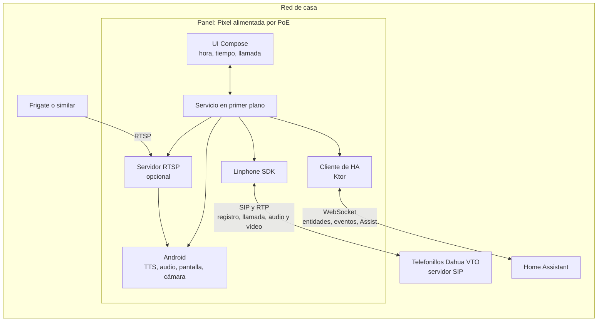

# marc2d

**M**óvil **A**ndroid **R**eciclado **C**omo **C**onsola **D**omótica: MAR + C² + D.

App Android que convierte un móvil fijo en la pared en la consola de la casa. Atiende los telefonillos
por SIP, muestra y ejecuta lo que le pide Home Assistant y, si se activa, ofrece su cámara a Frigate.
La lógica de la casa sigue en Home Assistant: el panel no es la centralita.

El proyecto está en pruebas y sin usuarios. Todavía es un esqueleto: el alcance y el orden de entrega
están en [SPEC.md](SPEC.md).

## Arquitectura



| Conexión  | Quién la inicia | Para qué                                                             |
| --------- | --------------- | -------------------------------------------------------------------- |
| SIP y RTP | los dos         | el panel se registra; el telefonillo llama; audio y vídeo            |
| WebSocket | el panel        | `weather.*`, `binary_sensor.*`, `marc2d_say`, `marc2d_siren`, Assist |
| RTSP      | Frigate         | leer el vídeo de la cámara del panel                                 |

El telefonillo solo funciona desde la red de casa: por Tailscale, el SNAT del router de subred impide que
el telefonillo alcance al panel.

## Stack

Kotlin y Jetpack Compose sobre Kotlin Toolchain, Linphone SDK, Ktor Client, kotlinx.serialization,
DataStore, RootEncoder y RTSP-Server. Los motivos están en [SPEC.md](SPEC.md#decisiones).

## Desarrollo

El script `./kotlin` descarga lo que necesita, sin instalar nada antes.

```sh
./kotlin build -m app        # compila la APK
./kotlin check               # ktlint, reglas de Compose y tests
./kotlin do ktlintFormat     # corrige el formato

adb -s <serie> install -r build/tasks/_app_buildAndroidDebug/gradle-project-debug.apk
```

La CI ejecuta lo mismo y además markdownlint. Las normas de trabajo están en [AGENTS.md](AGENTS.md).

## Licencia

[GPLv3](LICENSE).
