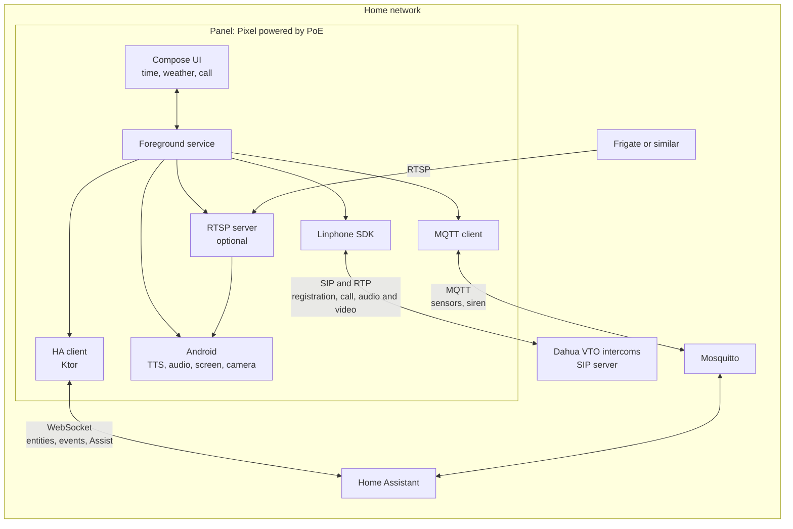

# marc2d

**M**óvil **A**ndroid **R**eciclado **C**omo **C**onsola **D**omótica: MAR + C² + D.
(Spanish for "recycled Android phone as a home automation console".)

Android app that turns a phone fixed to the wall into the console of the house. It handles the intercoms
over SIP, shows and carries out what Home Assistant asks of it and, if enabled, offers its camera to Frigate.
The house logic stays in Home Assistant: the panel is not the control hub.

The project is in testing and has no users. It is still a skeleton: the scope and delivery order
are in [SPEC.md](SPEC.md).

## Architecture



| Connection  | Who starts it | What for                                                 |
| ----------- | ------------- | -------------------------------------------------------- |
| SIP and RTP | both          | the panel registers; the intercom calls; audio and video |
| WebSocket   | the panel     | configuration, `weather.*`, `binary_sensor.*`, Assist    |
| MQTT        | the panel     | entity creation, sensors, siren and availability         |
| RTSP        | Frigate       | reading the video from the panel's camera                |

The intercom only works from the home network: over Tailscale, the subnet router's SNAT prevents the
intercom from reaching the panel.

## Stack

Kotlin and Jetpack Compose on Kotlin Toolchain, Linphone SDK, Ktor Client, kotlinx.serialization,
DataStore, RootEncoder and RTSP-Server. The reasons are in [SPEC.md](SPEC.md#decisions).

## Development

The `./kotlin` script downloads what it needs, with nothing to install first.

```sh
./kotlin build -m app        # builds the APK
./kotlin check               # ktlint, Compose rules and tests
./kotlin do ktlintFormat     # fixes the formatting

adb -s <serial> install -r build/tasks/_app_buildAndroidDebug/gradle-project-debug.apk
```

CI runs the same, plus markdownlint. The working rules are in [AGENTS.md](AGENTS.md).

## Setting up a panel

1. In Home Assistant, create `script.marc2d_config` with the format in [SPEC.md](SPEC.md#configuration) and a
   long-lived token.
2. Install the APK on a phone with no screen lock or accounts, and enable kiosk mode on it:

   ```sh
   adb -s <serial> shell dpm set-device-owner dev.xoa.marc2d/.PanelAdminReceiver
   ```

3. On LineageOS with restricted networking enabled, new apps have no network. Go to Settings, Apps, marc2d,
   **Wi-Fi data usage** and enable **Allow network access**. Otherwise the app fails with `UnknownHostException` or
   `SocketTimeoutException` even though the phone can reach Home Assistant.
4. Open the app and enter the Home Assistant URL and the token.

While the app is the device owner, Android will not let you uninstall it. To undo this: long-press the
clock and choose **Exit kiosk mode**.

## License

[GPLv3](LICENSE).
