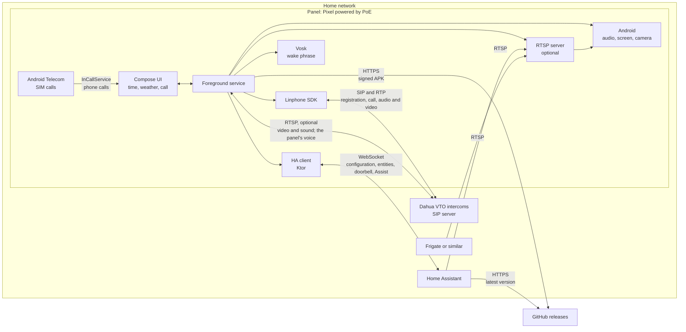

# marc2d

[](https://github.com/xoadev/marc2d/actions/workflows/ci.yml)

**M**óvil **A**ndroid **R**eciclado **C**omo **C**onsola **D**omótica: MAR + C² + D. In English, a
recycled Android phone turned into a home console.

marc2d turns an old phone, fixed to the wall, into your home's console: clock and weather, video
intercom, cameras, siren and sensors, connected to [Home Assistant](https://www.home-assistant.io/). The
logic stays in Home Assistant: the panel is not the hub.

It's a half-joking personal project, shared in case it's useful to someone.

## What it does

- **Clock and weather** on a black screen, designed for OLED panels that stay on all day.
- **Intercom:** it rings, you answer with audio and video, and you can call it yourself, over SIP or, for intercoms
  with an RTSP backchannel, over RTSP from the moment it rings. Tested with a Dahua VTO2202F.
- **Phone calls**, if the phone has a SIM: they ring and you answer on the same call screen, on the speaker.
- **Cameras** from Home Assistant in full screen, swiping from one to the next.
- **Sensors and siren** in Home Assistant: light, battery, temperature, presence, Wi-Fi, whether the camera is on, and
  a siren on the alarm channel.
- **Readings and charts** of any entity: tiles on the main screen, such as the car's battery, and hourly charts in the
  menu, such as the electricity price.
- **Updates** from Home Assistant, installed by the panel itself.
- **A speaker** for `tts.speak` and any other audio from Home Assistant.
- **Voice commands**, off by default: it listens for a wake phrase, configurable, on the device and sends what
  follows to Assist.
- **A droid**, 16×16 pixels, that wanders around the screen and shows what's going on with the color of
  its eye.

## Status

In testing, with a single panel. Releases are published by hand from `main`. Things still break freely.

## What you need

- A phone with Android 15 or later. It's used with LineageOS and without Google services.
- Home Assistant.
- For the intercom, a device that works as a SIP server on your home network.

## Architecture



| Connection  | Who starts it | What for                                                 |
| ----------- | ------------- | -------------------------------------------------------- |
| SIP and RTP | both          | the panel registers; the intercom calls; audio and video |
| WebSocket   | the panel     | configuration, entities, doorbell, weather, Assist       |
| RTSP        | HA or Frigate | reading the video; the camera is only on during it       |
| RTSP        | the panel     | the intercom's video and sound, and its voice, if set    |
| HTTPS       | HA, the panel | HA looks for new versions; the panel downloads the APK   |

The intercom only works from the home network: over Tailscale, the subnet router's SNAT prevents the
intercom from reaching the panel.

## Stack

Kotlin and Jetpack Compose on Kotlin Toolchain, Linphone SDK, Ktor Client, kotlinx.serialization,
DataStore, Vosk, CameraX and ZXing, with our own small RTSP server for the camera. The reasons are in
[SPEC.md](SPEC.md#decisions).

## Development

Everything runs through `make`, and the `./kotlin` script it uses downloads what it needs, with nothing to install
first.

```sh
make check       # lint, tests and the APK, as CI does
make format      # fixes the formatting
make help        # lists the rest

adb -s <serial> install -r build/tasks/_app_buildAndroidDebug/gradle-project-debug.apk
```

CI also runs hassfest, the HACS validation and actionlint. The working rules are in [AGENTS.md](AGENTS.md).

## Setting up a panel

1. In Home Assistant, install the integration: in HACS, add this repository as a custom repository of type
   Integration.
2. Install the APK on a phone with no screen lock or accounts, and enable kiosk mode on it:

   ```sh
   adb -s <serial> shell dpm set-device-owner dev.xoa.marc2d/.PanelAdminReceiver
   ```

3. On LineageOS with restricted networking enabled, new apps have no network. Go to Settings, Apps, marc2d,
   **Wi-Fi data usage** and enable **Allow network access**. Otherwise the app fails with `UnknownHostException` or
   `SocketTimeoutException` even though the phone can reach Home Assistant.
4. In Home Assistant, add the marc2d integration, name the panel, scan its QR code from the app and set the
   panel up in the integration's options.

While the app is the device owner, Android will not let you uninstall it. To undo this: tap the
clock, open **Settings** and choose **Exit kiosk mode**.

## License

[GPLv3](LICENSE).
